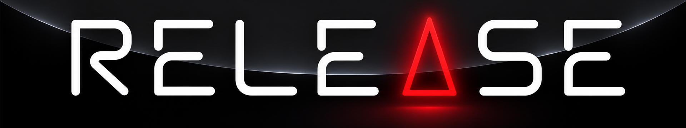

# Release for VectorPie

**Release** on a real vector monitor: a port of the mobile game *Release* by **Gimogames** to
[VectorPie](https://github.com/Goldfinch2/VectorPie), a Raspberry Pi 5 arcade cabinet with a
USB-DVG vector board.

VectorPie version by **Endprodukt**. Original game by **Gimogames**.



## The game

You are a hexagon in the middle of the screen. Enemies fly in from every side. Hold the
button and a ring opens around you. Let go while an enemy is inside the ring's band and it is
destroyed; the more you take at once, the more each is worth. Let the yellow stars live (they
pay you points every two seconds) and let the green balls hit you (a shield, a faster or a
wider ring). Anything else that touches you ends the game.

Two gameplay styles, chosen in the service menu (STYLE):

- **Original**: the Android game's own rules, rebuilt from the APK (Unity IL2CPP): its units,
  speeds, spawn waves, enemies (fighter, diver, stealth fighter, kite with its tail, carrier,
  ally star, power-ups) and scoring. The details are in [`docs/android_*.md`](docs).
- **Vectrex**: Malban's Vectrex version of Release, ported from its 6809 source with the same
  50 Hz timing, phase tables and quirks ([`docs/spec_core.md`](docs/spec_core.md),
  [`docs/spec_objects.md`](docs/spec_objects.md)).

What the VectorPie version adds:

- Enemies and objects as turning 3D wireframe models in the original's colours.
- Explosions in the spirit of Tempest 2000: rings and spheres of dots, white flashes, models
  breaking into their edges, sparks, a shock wave from the released ring, and a big chain
  reaction with screen shake when you die.
- An attract mode: the logo, a short animated tutorial, the enemy guide, the high scores and a
  demo game.
- High scores with initials (one button plus START, with a visible countdown), seeded with a
  default table.
- The original's music and sounds, plus "Starship 8-Bit" as the game music, each looping
  seamlessly after playing once from the start.
- The cabinet's shared service menu (style, attract sound, high score reset, button layout,
  volumes).
- Every frame is kept light for the USB-DVG: scattered dots are drawn in a short path so the
  picture stays steady.

## Controls

| control | what |
|---|---|
| Button (P1 buttons 1-4 by default, re-mappable) | hold to open the ring, release to fire |
| START 1 or any button | start a game (title, demo, Play Again) |
| Button / START | initials: next letter (hold to run) / take the letter |
| Tab or F2 | the service menu (also re-mappable) |
| Esc (the cabinet's exit) | back to the VectorPie menu |

## Building

The game is C99 on the VectorPie SDK (0.9). The SDK has to be built and installed first
(`cmake --install` in the SDK puts it in `~/VectorPie/dist/<platform>`).

**PC test build** (WSL, Ubuntu 24.04, a window through WSLg):

```sh
cd release-vp
cmake --preset linux && cmake --build --preset linux
~/build/release-vp/linux/release --windowed
```

**On the cabinet**: the game is built natively on the Pi. From Windows,
[`release-vp/tools/deploy.ps1`](release-vp/tools/deploy.ps1) copies the sources and the SDK to the
cabinet, builds and packages them there (`tools/build-on-cabinet.sh`) and installs the package over
the old one, keeping its saves. A new game (not an update) shows in the menu after a reboot.

```powershell
powershell -File release-vp\tools\deploy.ps1 [-Cabinet 192.168.0.122]
```

**Simulator** ([`release-vp/tools/sim/sim.c`](release-vp/tools/sim/sim.c)): runs the game without
the SDK or a window, with a bot, and writes frames as SVG. It also measures what each frame costs
the vector board (`SIM_LINES=1`, `SIM_COST=1`). See [`release-vp/README.md`](release-vp/README.md).

## Repository layout

| path | what |
|---|---|
| `release-vp/src/main.c` | screens, attract mode, sound and music, settings, high scores, the Vectrex gameplay |
| `release-vp/src/original.c` | the Android original's gameplay, the 3D models and the effects |
| `release-vp/src/service.c` | the cabinet's shared service menu |
| `release-vp/src/vpbind.c` | the controls (shared by the cabinet's games) |
| `release-vp/src/data.c`, `release.h` | the Vectrex version's tables and shapes |
| `release-vp/src/font_xspace.inc` | the original's font as strokes (generated by `tools/make-font`) |
| `release-vp/assets/sounds/` | sounds and music |
| `release-vp/package/` | the package manifest (`game.ini`) and the marquee |
| `release-vp/tools/` | deploy and build scripts, the simulator, the font and music tools |
| `docs/` | the specifications the gameplay follows |
| `STATUS.md` | what is done, known limitations, version history |
| `RESUME.md` | how to continue the work: environment, cabinet, build and check steps |

## Credits

- **Release** (the original game, its sounds, title music and font): Gimogames.
- **Vectrex version**: Malban, public domain; ported with his permission.
- **VectorPie SDK**: Goldfinch2.
- **"Starship 8-Bit"** (the game music): chosen by Endprodukt; its rights stay with its author
  and are not covered by this repository.
- **VectorPie version**: Endprodukt.

No license is granted for this repository: all rights reserved.
